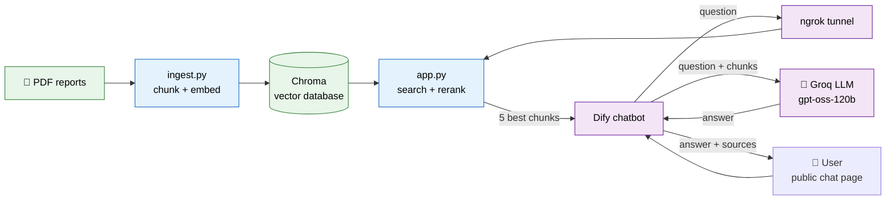
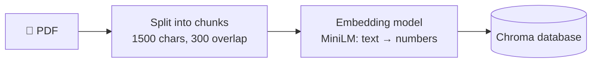
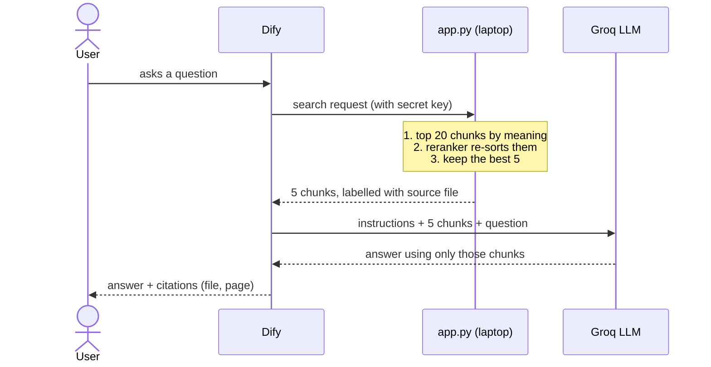

# Project Overview

A chatbot that answers questions from PDF reports and shows where each answer came from.

## 1. The big picture

🟩 data &nbsp; 🟦 my code (runs on my laptop) &nbsp; 🟪 external services

## 2. Phase A: preparing the documents (once)

## 3. Phase B: answering one question

